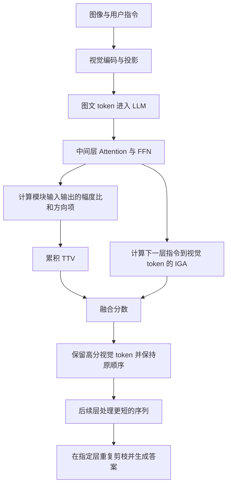

# TransPrune 深度阅读：问题、方法、创新与相关工作

> 论文：Ao Li et al. **TransPrune: Token Transition Pruning for Efficient Large Vision-Language Model**，CVPR 2026，39529–39538。  
> 阅读日期：2026-09-29。以本地 CVPR 正式版正文、补充材料为主要依据，并核对相关工作的原论文与本地官方代码。  
> 本文的实验数字均为作者报告，尚未在本机复现实验。标为“理解”“分析”“建议”的内容是阅读判断，不是论文证明的结论。

## 阅读结论

**TransPrune 解决的是视觉语言模型中“哪些视觉 token 可以删掉”的问题。它把 token 经过模块时的幅度与方向变化作为重要性信号，再结合用户指令的注意力，在 LLM 中间层逐步剪枝。**

它最值得学习的研究思路，是将模型内部表示的变化用于推理阶段的资源分配。创新应放在 LVLM 剪枝场景、中间层的实证观察以及 TTV、IGA、跨层累积的组合上理解：更早的 TokenTM 已经研究过用长度比和方向相关性度量 token transformation。

复现前尤其要留意：**论文的方向项是 `1 - abs(cos)`，本地官方代码当前启用的是 `1 - cos`**；评分归一化、下一层 IGA、token 保留比例的基准，也需要逐项对齐。

---

## 1. 这篇论文为了解决什么问题？

### 1.1 计算瓶颈：视觉 token 多，后续层反复处理它们

典型 LVLM 把图像转换为视觉 token，经投影后与文字 token 一起送入语言模型。LLaVA-v1.5 的论文实验以 576 个视觉 token 为基准；高分辨率模型和视频模型会产生更多视觉 token。

一张图片中，大量背景、重复纹理以及与问题无关的区域，并不需要在每一层都保持同等计算量。即使最终只回答几个字，模型仍要先处理较长的图文输入。

从 Transformer 的结构看，序列变长会增加注意力计算，也会增加每个 token 的投影、FFN 计算和相应缓存。剪掉视觉 token，可以减少它们在后续层的计算；已经在早期层花掉的计算不会因此消失。

### 1.2 真正的难点：重要性怎样定义？

“删多少”可以事先设定，“删谁”决定性能损失。

论文讨论了两类常用依据的局限：

| 依据 | 基本做法 | 容易出现的问题 |
|---|---|---|
| Attention | 保留获得较多注意力的视觉 token | 注意力可能受序列位置影响；高权重未必等于对答案有贡献 |
| Similarity / Diversity | 合并相似 token，或保留覆盖面更广的子集 | 仅凭视觉相似性，难以判断当前指令需要什么信息 |

例如，图中有一个大沙发和一小块标牌。若用户问标牌上的文字，面积较小的文字区域可能更重要。单纯保留显眼区域或典型视觉特征，不一定能保留回答所需证据。

这里要避免扩大论文的批评范围：**并非所有相似性或多样性方法都忽略指令**。论文自己引用的 CDPruner 就通过条件多样性引入了指令信息。

### 1.3 论文的研究问题与任务边界

研究问题可以概括为：

> 能否从视觉 token 在 LLM 内部经历的表示变换中，提取一种成本较低、能补充注意力的重要性信号？

目标是无需重新训练模型，在较少计算量下保持多模态任务性能。

它属于 **within-LLM visual token pruning**：

- 主要在语言模型内部删除视觉 token。
- 预先设定剪枝层和保留数量，再对每个输入动态选择保留对象。
- 不以删除模型参数、量化权重或训练新视觉编码器为主要手段。
- 实验面向图像问答、理解和视频问答；正文没有机器人动作预测或闭环控制实验。

依据：正文第 1、2 节，图 2，表 1–6。[正文来源][paper]

## 2. 论文原理和方法是什么？

### 2.1 总体流程



可以用两个问题理解两种分数：

- **TTV：模型对这个视觉 token 做了怎样的变换？**
- **IGA：当前问题在多大程度上关注这个视觉 token？**

### 2.2 “Transition”具体比较什么？

设模块输入为向量 $x_i$，模块输出为 $y_i=F(x)_i$。这里的 $F$ 可以是自注意力或 FFN。对于注意力，输出仍然会依赖其他 token；“逐 token 计算分数”不意味着注意力模块只处理一个孤立 token。

论文图 2 指定排除残差连接。本地代码进一步表明：

- Attention 分支：比较 RMSNorm 后、进入 attention 前的表示，与 attention 输出且尚未加 residual 的表示。
- FFN 分支：比较 post-attention RMSNorm 后的表示，与 MLP 输出且尚未加 residual 的表示。

因此，不能直接用整个 Transformer 层的 $h^{l+1}-h^l$ 替代论文测量。残差相加前后、归一化前后，得到的数值和解释都会不同。

代码依据：[模块输入输出位置][code-io]。

### 2.3 TTV：幅度比 × 方向权重

#### （1）幅度比

正文公式（1）：

$$
m_i=\frac{\|y_i\|_2}{\|x_i\|_2}.
$$

它衡量输出相对输入的向量长度。对于论文观察到的很多模块输出，幅度比更大可理解为变换分支输出相对更强、幅度缩减更少。

**它不是欧氏距离 $\|y_i-x_i\|_2$，也不是 $|\|y_i\|_2-\|x_i\|_2|$。**“幅度变化越大越重要”只是粗略说法，复现时必须使用具体定义。

#### （2）方向项

先计算余弦相似度：

$$
c_i=\frac{y_i^\top x_i}{\|y_i\|_2\|x_i\|_2}.
$$

论文使用：

$$
u_i=1-|c_i|.
$$

| 输入输出关系 | $c_i$ | $1-\lvert c_i\rvert$ |
|---|---:|---:|
| 同向 | 1 | 0 |
| 正交 | 0 | 1 |
| 反向 | -1 | 0 |

所以，它偏好的是**接近正交的变换**，并不是“夹角越大越重要”。180° 的反向变化在这个定义下并不会获得最高分。

#### （3）组合为模块级分数

正文公式（2），对视觉 token 的方向项做 softmax，再与幅度比逐元素相乘：

$$
\operatorname{TTV}_{F,i}
=m_i\frac{\exp(1-|c_i|)}{\sum_{j\in\mathcal V}\exp(1-|c_j|)}.
$$

$\mathcal V$ 表示当前视觉 token 集合。这种组合同时考虑模块输出强度与方向特征。

**一个帮助理解的例子（非论文实验）：**假设 A、B 的幅度比分别为 0.8、0.2，余弦相似度分别为 0.1、0.9。方向项为 0.9、0.1，softmax 后约为 0.690、0.310，TTV 约为 0.552、0.062。因此 A 更可能被保留。这说明公式如何排序，并不证明 A 必然包含更多语义。

单层得分是两条分支的和，见公式（3）：

$$
\operatorname{TTV}_{l,i}
=\operatorname{TTV}_{\mathrm{Attention}_l,i}
+\operatorname{TTV}_{\mathrm{FFN}_l,i}.
$$

### 2.4 为什么选择中间层，并累积分数？

图 2 的可视化显示，与语义区域对应的变换模式在中间层更集中、明显。作者据此选择中间层作为信号来源。

但单层结果有波动，因此不只根据一个层的分数做决定，而是将多个层的 TTV 相加：

$$
\overline{\operatorname{TTV}}_{p,i}
=\sum_{l\in\mathcal A,\,l\le p}\operatorname{TTV}_{l,i}.
$$

默认设置为：

- 累积层：$\mathcal A=\{7,8,9,10,11,12\}$。
- 剪枝层：$\mathcal P=\{7,9,12\}$。

对应关系：

| 剪枝位置 | 使用的 TTV 历史 |
|---|---|
| 第 7 层之后 | 第 7 层 |
| 第 9 层之后 | 第 7、8、9 层 |
| 第 12 层之后 | 第 7–12 层 |

剪枝之后，旧分数也必须按保留的 token 索引裁剪，保证历史分数和当前 token 一一对应。累积不是每次剪枝后清零。

补充材料用残差结构和信息瓶颈给出直觉解释：不重要的信息可能更多沿恒等路径传播，中间层可能承担去除无关信息、整合任务特征的过程。**这属于解释性假说；材料没有给出“TTV 高必然对答案更重要”的严格证明。**

### 2.5 IGA：用指令补足任务相关性

视觉内容本身重要，不代表它对当前问题重要。因此论文对指令 token 到视觉 token 的注意力求平均：

$$
\operatorname{IGA}_i=\frac{1}{L}\sum_{j=1}^{L}A_{j,i},
$$

其中 $L$ 为指令 token 数，$A_{j,i}$ 为第 $j$ 个指令 token 对第 $i$ 个视觉 token 的注意力。

代码还对多个注意力头求均值。IGA 不跨层累积。

理解 TTV 的“与指令独立”时，较准确的表述是：**TTV 的评分公式没有显式使用指令到图像的相关性**。这不等于任意架构的隐藏表示都完全不受文本影响；要看序列顺序和注意力掩码。

### 2.6 融合评分：特别注意下一层下标

正文公式（6）：

$$
s_{p,i}=\alpha\overline{\operatorname{TTV}}_{p,i}
+(1-\alpha)\operatorname{IGA}_{p+1,i},\qquad\alpha=0.5.
$$

这里使用的是 **$p+1$ 层的 IGA**。第 $p$ 层完成后，代码借助下一层的归一化、Q/K 投影和位置编码计算用于排序的注意力，再筛选进入下一层的视觉 token。

因此，不能把它写成“直接取当前层 attention 输出”。也不需要先完整运行下一层的 Attention 和 FFN 再删除 token。

评分后选取 top-k 视觉 token，并按原序列位置重新排列。文字 token 保留。代码还对累积 TTV 和 IGA 分别做总和归一化，再将两者相加；这一步在正文公式（6）中没有显式展开。

依据：[下一层注意力与融合实现][code-rank]。

### 2.7 剪枝预算：比例相对于最初的视觉 token 数

补充材料表 1 给出两套预算：

| 配置 | 第 7 层后保留比例 | 第 9 层后保留比例 | 第 12 层后保留比例 | 初始 576 token 时的变化 |
|---|---:|---:|---:|---|
| TransPrune-High | 0.875 | 0.625 | 0.125 | 576 → 504 → 360 → 72 |
| TransPrune-Low | 0.625 | 0.1875 | 0.0625 | 576 → 360 → 108 → 36 |

这些比例都是相对原始数量，不能把它们连续相乘。High 表示保留较多 token、计算预算较高；Low 剪枝更强。

72 和 36 的具体数量对应这里的 576-token 输入。对 LLaVA-NeXT 等输入 token 数可变化的情况，应按实际初始数量计算。[补充材料][supp]

### 2.8 为什么能加速，并兼容 FlashAttention？

TTV 主要需要逐 token 的范数、点积等运算。IGA 只需要指令查询对应的注意力行，无需返回完整的所有 token 对所有 token 的注意力权重。因此主要 attention 计算可以继续使用 FlashAttention。

这里的兼容意味着可以另外计算评分所需的部分注意力，**不意味着 IGA 没有额外成本**。当前代码还计算了 Q/K/V 投影，并创建了因果掩码；实际开销应以实现和实测为准。

正文公式（7）给出了简化计算量估计。复现时更稳妥的做法是分层统计序列长度、计入评分运算，再实测延迟。逐 token 的 TTV 运算显然随 token 数和隐藏维度增长，不能把公式中简写的低阶项理解成完全不依赖 token 数。

## 3. 有什么创新点，相比已有工作有什么优点？

### 3.1 创新点应怎样定位？

#### 创新一：将 token 自身的变换用于 LVLM 剪枝评分

只看注意力时，主要关注 token 之间的信息分配。TransPrune 增加了一个维度：同一个视觉 token 经过 Attention、FFN 后，模块输出相对输入发生了怎样的变化。

但“范数比 + 方向相关性衡量 token transformation”有 TokenTM 等前序工作。这里的贡献是把这一思路落到 **LVLM 内部的视觉 token 选择与推理加速**，并验证中间层信号的有效性。

#### 创新二：用跨中间层累积提高评分稳定性

论文没有只挑某一层的瞬时分数，而是利用到当前剪枝位置为止的 TTV 历史。其作用是降低单层波动导致的误删。

#### 创新三：TTV 与 IGA 互补

TTV 提供表示变换信息，IGA 提供显式的指令相关性。论文的重点在于组合后的效果，而不是宣称指令引导注意力本身首次出现。

#### 创新四：形成无需训练、可组合的推理方案

方案可以作用于多个 LVLM，也可以与进入 LLM 之前的视觉压缩结合。无需训练、逐层剪枝和 FlashAttention 兼容各自都有前例，它们是实用优势，不能单独视为本文独有贡献。

### 3.2 主结果：较低计算量下保持较高汇总性能

正文表 1，LLaVA-v1.5-7B：

| 方法 | TFLOPs | 原始计算量占比 | 论文汇总相对性能 Acc. |
|---|---:|---:|---:|
| 原始模型 | 3.82 | 100% | 100.0% |
| FastV，较温和配置 | 2.01 | 52.6% | 97.8% |
| PDrop，较温和配置 | 1.78 | 46.6% | 98.8% |
| SparseVLM，较温和配置 | 1.57 | 41.1% | 98.8% |
| TransPrune-High | 1.56 | 40.8% | 100.0% |
| TransPrune-Low | 1.19 | 31.2% | 98.4% |

其中 SparseVLM 的 1.57 TFLOPs 与 TransPrune-High 的 1.56 TFLOPs 很接近，这一组更适合比较相近计算预算下的效果。其他方法的预算并不完全相同。

High 相对原始模型减少约 **59.2%** 计算量；Low 减少约 **68.8%**。汇总相对性能 100.0% 不代表答对所有题，也不代表每项任务无损：High 的 TextVQA 从 58.2 降为 57.8，POPE 从 85.9 降为 85.0，而 MME 从 1506 升为 1540。

正文表 2 中，LLaVA-NeXT-7B 的 High 配置从 20.83 降至 8.33 TFLOPs，保留 99.8% 汇总相对性能，说明收益不只出现在固定低分辨率输入。

正文表 3 中，Qwen2.5-VL-7B 的计算量降至原始的 45.1%，但 MME 从 1634 降至 1580，ScienceQA 从 79.6 降至 78.1。它支持跨架构有效性，也显示“保持性能”不等于每个模型、每项指标都不下降。

正文表 6 将方法用于 Video-LLaVA，TFLOPs 从 14.4 降为 6.1，TGIF 和 MSVD 指标接近或略高于原始模型。证据限于文中的视频问答设置，不能直接外推到所有长视频任务。

### 3.3 消融实验：哪些设计确实有贡献？

正文表 12：

| 配置 | MME | ScienceQA | GQA | MMBench |
|---|---:|---:|---:|---:|
| 仅 IGA | 1514 | 69.0 | 61.1 | 65.6 |
| IGA + 方向 | 1521 | 69.1 | 61.2 | 65.4 |
| IGA + 幅度 | 1532 | 69.4 | 61.4 | 65.7 |
| IGA + 完整 TTV | 1540 | 69.5 | 61.4 | 66.0 |

合理结论是：幅度和方向都有补充作用，这组实验中幅度贡献更明显，联合使用的综合表现最好。不能说方向项在所有指标上都提升，因为 MMBench 的方向单独增量略有下降。

正文表 11 中，加入累积后 MME 为 1530 → 1540，MMBench 为 65.7 → 66.0，GQA 保持 61.4。它支持累积有帮助，但增益规模相对温和。

正文表 10 固定剪枝位置，对比浅层与中间层累积：MME 为 1515 → 1540，支持中间层 TTV 更有效。表 9 的不同剪枝位置还会同时改变 FLOPs，因此不能把其中差异全部归因于语义信号质量。

### 3.4 TTV 与 IGA 确实互补，但 TTV 不是万能评分

正文表 7 的 TTV-only：

- TextVQA：58.2 → 50.9。
- GQA：61.9 → 58.4。
- POPE：85.9 → 82.1。

这些结果说明，仅靠内部变换很难完整替代任务相关性。尤其细粒度文字阅读任务，对关键区域误删更敏感。论文将 TextVQA 的下降归因于缺少指令相关语义，这是一种解释，仍可通过更细的案例分析验证。

补充材料表 2 还显示：方向项用 `cos` 时 MME 为 1539、MMBench 为 66.1；用 `1 - abs(cos)` 时分别为 1540、66.0。两者非常接近，所以不能把某个方向函数本身描述成决定性的突破。

### 3.5 实际延迟优势：存在，但小于“计算量下降”的直觉

正文表 8，MME 上的作者测量：

| 方法 | Latency（ms） | Memory（GB） | MME |
|---|---:|---:|---:|
| FastV | 125.2 | 14.99 | 1474 |
| PDrop | 115.2 | 14.87 | 1500 |
| SparseVLM | 129.1 | 19.05 | 1484 |
| TransPrune | 111.4 | 14.82 | 1540 |

TransPrune 在这组配置中同时取得最低延迟和最高 MME。相对 FastV 的延迟下降约 11.0%，相对 PDrop 约 3.3%。

**59.2% FLOPs 降低不能直接转换成 59.2% 实际耗时降低。**表 8 没有列出未剪枝模型的延迟，也没有在表中完整定义端到端计时边界。复现应明确分别测量视觉编码、prefill、decode 和总耗时。

### 3.6 可与前置压缩组合

正文表 4：VisionZip 先保留 192 个 token，之后结合 TransPrune 最终保留 24 个，计算量为 0.44 TFLOPs，即原始模型的 11.5%，汇总相对性能为 97.2%。

“几乎无性能损失”的比较对象在这里是 VisionZip 单独配置的 97.2%；相对完整原始模型仍存在下降。表 4 使用六项基准，表 1 使用八项基准，汇总数字不宜不加区分地横向比较。

### 3.7 证据边界与不足

1. **经验信号多于严格理论。**相关可视化和消融支持设计有效，但没有证明变化幅度与 token 的因果贡献一一对应。
2. **中间层范围依赖模型。**默认 7–12 层不是对所有深度、架构都适用的定律。
3. **位置偏差只能说得到缓解。**图 4 中 TTV 更少出现序列首尾尖峰，但仍明显偏向中间位置；图像内容分布可能也有影响。
4. **损失取决于任务和预算。**汇总性能可能掩盖 OCR、计数、小物体识别等任务的下降。
5. **缺少不确定性报告。**表中没有置信区间或多次运行的方差，微小差异不宜解释为稳定优势。
6. **论文与代码并非完全一致。**需要先明确复现的是论文公式还是当前公开实现，再解释结果。

## 4. 相关工作有哪些，借鉴的 idea 在哪里？

### 4.1 最直接的方法来源：TokenTM

**Token Transformation Matters: Towards Faithful Post-hoc Explanation for Vision Transformer（CVPR 2024）** 是正式版参考文献 [29]。TransPrune 在引出幅度与方向测量时明确引用它。

TokenTM 用长度比与归一化的指数余弦相关性衡量变换，并将其纳入跨层贡献传播，以解释 ViT 的预测。TransPrune 则将类似的测量用于 LVLM 剪枝，采用中间层分数累积和指令注意力融合。[TokenTM 原文第 4.2–4.3 节][tokentm]

因此，**“token 的变换本身有用”有直接前序来源；“如何将其做成有效的 LVLM 剪枝方案”是本文的主要增量。**这也比将 DynamicViT 视为 TTV 公式的直接来源更准确。

### 4.2 相关工作与关系表

表中的“关系”区分明确引用、结构相似和实验比较。论文引用一个方法，并不能自动证明每个组件都直接借用了该方法。

| 工作 | 主要 idea | 与 TransPrune 的关系 | 主要区别 |
|---|---|---|---|
| [TokenTM][tokentm] | 结合长度比、方向相关性刻画 token transformation | 幅度与方向测量段落明确引用，是最直接的方法关联 | 原任务是 ViT 事后解释；本文用于 LVLM 在线剪枝 |
| [DynamicViT][dynamicvit] | 训练轻量预测模块，按输入逐层稀疏化 token | 引言“动态变化”动机处引用；也是渐进 token 稀疏化的早期背景 | 本文不训练重要性预测器 |
| [FastV][fastv] | 利用浅层注意力选择视觉 token，减少后续计算 | 模型内部剪枝的重要基线；本文也引用其层间视觉冗余分析 | 本文加入 TTV，并采用多阶段决策 |
| [PyramidDrop / PDrop][pdrop] | 随模型层数加深，分阶段降低视觉 token 数 | 渐进式、金字塔式预算与本文结构相似；是直接比较基线 | 本文重点改变重要性评分，采用累积 TTV + IGA |
| [SparseVLM][sparsevlm] | 用相关文字 token 评估视觉 token，并结合稀疏化与 token 回收 | “文本指导视觉选择”与 IGA 有直接概念联系 | 本文对指令注意力求平均，并与 TTV 融合；不使用同样的回收流程 |
| [VisionZip][visionzip] | 在送入 LLM 前减少视觉冗余 | 位置不同，可与本文组合；正文表 4 验证 | 前置压缩能减少早期层计算；本文利用 LLM 中间表示 |
| DivPrune | 用 Max-Min Diversity 选择多样的视觉子集 | 正文第 2.2 节的前置压缩代表 | 主要关注子集覆盖与多样性，本文关注表示变换与指令 |
| [CDPruner][cdpruner] | 通过 DPP 最大化指令条件下的视觉多样性 | 体现“去冗余也要考虑任务”的路线；正文表 5 组合 | 本文没有显式优化保留子集的多样性 |
| [PACT][pact] | 在早期语言层剪枝并聚类，使用非 attention 的重要性度量 | 本文关于注意力位置偏差的引用来源之一 | 说明脱离 attention 评分已有先例；本文具体使用 TTV |
| [Are We Solving the Right Problem?][rightproblem] | 审视 attention、指令信息与评估协议是否可靠 | 本文用于支持位置偏差和任务相关性的讨论 | 属于问题诊断与评价视角，不是本文算法的直接实现 |

此外，正文还比较了 TopV 和 ShortV。TopV 关注剪枝与推理优化的兼容性；ShortV 通过在效果有限的层冻结视觉 token 提高效率。它们属于相邻的推理加速路线，正文没有给出它们是 TTV 直接来源的证据。

### 4.3 用研究脉络串起来

```text
TokenTM：表示变换可以补充 attention 对重要性的描述
                         ↓
             中间层 TTV 作为剪枝信号
                         +
SparseVLM 等：视觉选择需要考虑文本任务 → IGA
                         +
DynamicViT / PDrop：随深度逐步缩短序列 → 多阶段预算
                         ↓
        跨中间层累积 TTV，并与 IGA 融合
                         ↓
            无需训练的 LVLM 内部剪枝
```

上图是基于引用与算法结构整理的理解，不代表作者声明逐一从这些方法继承了代码或全部设计。

### 4.4 建议优先阅读哪些前作？

若以复现 TransPrune 为目标，可按下列顺序阅读：

1. **FastV**：理解视觉 token 冗余、剪枝位置与基本评估方式。
2. **PyramidDrop**：理解分阶段剪枝和预算如何影响成本。
3. **TokenTM**：理解 TTV 测量最直接的方法背景。
4. **SparseVLM**：理解文本相关性为什么不能忽略。
5. **Are We Solving the Right Problem?**：检视位置偏差、随机基线和评估是否公平。
6. **VisionZip / CDPruner**：理解前置压缩及组合实验。

---

## 附录 A：面向复现的代码核对

### A.1 核对版本

- 官方远程仓库：[liaolea/TransPrune](https://github.com/liaolea/TransPrune)。
- 本地仓库：[TransPrune](E:/笔记/vla学习/论文复现/TransPrune)。
- 本次核对本地 HEAD：`c9e8284f5808f7692c40590ffc99537e9220a01d`。
- 核心实现：[modeling_llama_transprune.py](E:/笔记/vla学习/论文复现/TransPrune/llava/model/modeling_llama_transprune.py)。
- MME 入口：[mme.sh](E:/笔记/vla学习/论文复现/TransPrune/scripts/transprune/v1_5_test/mme.sh)。

本次只阅读代码，没有修改实现，也没有运行模型评测。下面记录的是上述本地提交的状态，不保证未来仓库保持一致。

### A.2 论文与代码需要对齐的七件事

| 项目 | 论文或预期语义 | 当前代码观察与复现影响 |
|---|---|---|
| 方向公式 | `1 - abs(cos)` | 第 925 行启用 `1 - cos`；对应论文公式的代码在第 923 行被注释。这是实质性差异 |
| 模块表示位置 | 排除 residual | 第 873–895 行取归一化后输入与残差相加前输出，不能替换为整个层的隐藏状态差 |
| TTV softmax 范围 | 公式对视觉 token 定义 | 第 926–927 行对传入张量用不指定维度的 `.sum()`；计算时尚未切出视觉区间，batch > 1 时还会包含跨样本归一化 |
| 融合前归一化 | 公式（6）未明确展开 | 第 1519–1523 行分别归一化 TTV 与 IGA，再求和。对归一化后的分数而言，这与等权平均的排序相同 |
| IGA 计算范围 | 指令对视觉 token 的注意力 | 代码先算指令 query 对完整 key 序列的注意力并 softmax，再截取视觉列和求均值；不能直接替换成只在视觉 key 上 softmax |
| 层编号 | 第 7、9、12 层后剪枝，IGA 用下一层 | `rank_layer = layer_idx + 1`，再使用 `self.layers[rank_layer]` 构造评分，涉及从 1 开始的论文层号与从 0 开始的数组下标 |
| batch 与历史分数 | 每个样本的 token 历史应独立 | 第 1530 行明确注明相关更新仅适用于 batch size 1；首轮复现宜固定 batch size 1 |

第三项的分析需谨慎：batch size 1 时，最后对视觉分数归一化可能消除某些公共尺度，但跨模块、跨层累积之前的尺度仍可能影响加权关系，不能未经验证认定等价。

第五项也有实际区别：先对完整 key 序列做 softmax，会保留不同指令 token 分配给视觉信息的相对注意力质量；若先只保留视觉 key 再 softmax，每一行都会被强制归一到视觉区域，聚合结果不一定一致。

对应代码：[TTV 函数][code-ttv]、[融合与历史裁剪][code-rank]。这些差异需要实验或作者说明才能确认对表格结果的影响，不能单凭静态阅读断言论文结果有误。

### A.3 最小复现顺序与成功标准

1. **先跑通原始 LLaVA-v1.5-7B。**在固定 checkpoint、prompt、精度和数据版本下得到自己的基线，保留逐样本输出。
2. **运行官方 High 配置。**确认第 7、9、12 层后视觉 token 数是 504、360、72，文字长度保持一致。
3. **优先评估 MME + TextVQA。**前者对应论文主要消融，后者更容易暴露细粒度信息丢失。完成后再扩展其余基准。
4. **单独对比两个方向公式。**其余条件固定，比较当前代码的 `1 - cos` 与论文的 `1 - abs(cos)`，分别记录结果。
5. **做关键消融。**IGA-only、TTV-only、去累积、完整方法；使用相同 token 预算和剪枝层。
6. **测量真实效率。**固定硬件与后端、预热并同步 CUDA，分别记录 prefill、decode、端到端延迟和峰值显存；统计实际保留 token 数。
7. **逐任务解释差距。**以本地原始模型为参照，检查退化是否集中在文字、计数或小区域相关样本。

目标应先是复现同环境下的质量与成本趋势，再追求表格数值接近。作者报告的设置包括 A100 40GB 和 FlashAttention；不同硬件上的毫秒数不宜直接比较。

脚本目前包含作者机器的绝对数据路径和 `CUDA_VISIBLE_DEVICES=2`，使用前需调整。`pyproject.toml` 固定了 `torch==2.1.2`、`transformers==4.37.2` 等依赖，不能假定替换为最新版本仍可直接运行。

## 附录 B：四个问题的简短回答

**1. 解决什么问题？** 视觉 token 过多导致 LVLM 推理成本高，而 attention 或视觉相似性不足以可靠判断哪些 token 可删。

**2. 原理和方法？** 用模块输入输出的范数比与方向关系计算 TTV，在中间层累积，再结合下一层的指令引导注意力 IGA，按预设预算多阶段删除低分视觉 token。

**3. 创新与优点？** 把 token transformation 用于 LVLM 剪枝，并验证中间层累积与任务注意力的互补；无需额外训练，较低 FLOPs 下性能较好，可兼容 FlashAttention 和前置压缩。优势有任务、预算与实现条件限制。

**4. 相关工作及 idea 来源？** TokenTM 是幅度与方向测量最直接的关联；FastV、PDrop 提供 LLM 内部冗余与逐阶段剪枝背景；SparseVLM 提供文本指导视觉选择的相关路线；PACT 和评估反思工作支持对 attention 偏差的关注；VisionZip、DivPrune、CDPruner 是前置压缩的比较与互补方法。

## 资料与定位

- [CVPR 2026 官方论文页面][cvf]；[本地正文 PDF][paper]。方法：第 3 节、公式（1）–（6）；主实验：表 1–6；消融与效率：表 7–13。
- [本地补充材料][supp]：第 1 节解释性讨论，表 1 预算设置，表 2 方向项对比。
- [arXiv 网页版](https://arxiv.org/html/2507.20630v2)：便于检索；本文涉及表格和参考文献编号时以 CVPR 正式版为准。
- [官方代码仓库](https://github.com/liaolea/TransPrune)：实现与实验入口。
- [TokenTM][tokentm]；[DynamicViT][dynamicvit]；[FastV][fastv]；[PyramidDrop][pdrop]；[SparseVLM][sparsevlm]。
- [VisionZip][visionzip]；[CDPruner][cdpruner]；[PACT][pact]；[Token Pruning in MLLMs: Are We Solving the Right Problem?][rightproblem]。

[paper]: E:/笔记/vla学习/论文复现/TransPrune.pdf
[supp]: E:/笔记/vla学习/tmp/pdfs/transprune-reading/TransPrune_supplemental.pdf
[cvf]: https://openaccess.thecvf.com/content/CVPR2026/html/Li_TransPrune_Token_Transition_Pruning_for_Efficient_Large_Vision-Language_Model_CVPR_2026_paper.html
[tokentm]: https://arxiv.org/html/2403.14552v1
[dynamicvit]: https://arxiv.org/abs/2106.02034
[fastv]: https://arxiv.org/abs/2403.06764
[pdrop]: https://arxiv.org/abs/2410.17247
[sparsevlm]: https://arxiv.org/abs/2410.04417
[visionzip]: https://arxiv.org/abs/2412.04467
[cdpruner]: https://arxiv.org/abs/2506.10967
[pact]: https://arxiv.org/abs/2504.08966
[rightproblem]: https://arxiv.org/abs/2502.11501
[code-io]: https://github.com/liaolea/TransPrune/blob/c9e8284f5808f7692c40590ffc99537e9220a01d/llava/model/modeling_llama_transprune.py#L869-L913
[code-ttv]: https://github.com/liaolea/TransPrune/blob/c9e8284f5808f7692c40590ffc99537e9220a01d/llava/model/modeling_llama_transprune.py#L917-L930
[code-rank]: https://github.com/liaolea/TransPrune/blob/c9e8284f5808f7692c40590ffc99537e9220a01d/llava/model/modeling_llama_transprune.py#L1453-L1536
